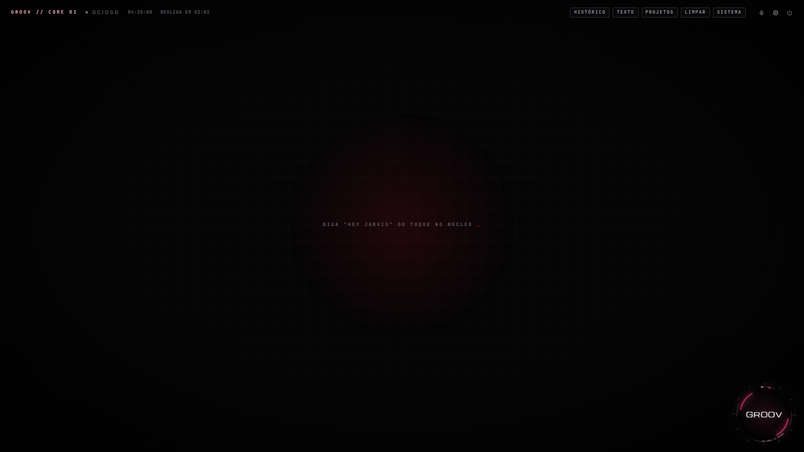
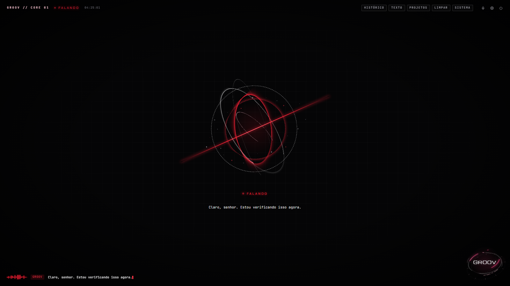
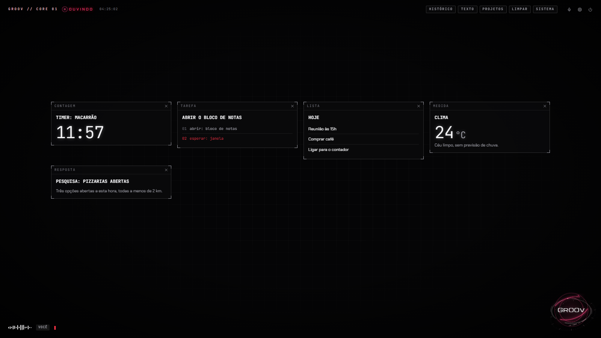
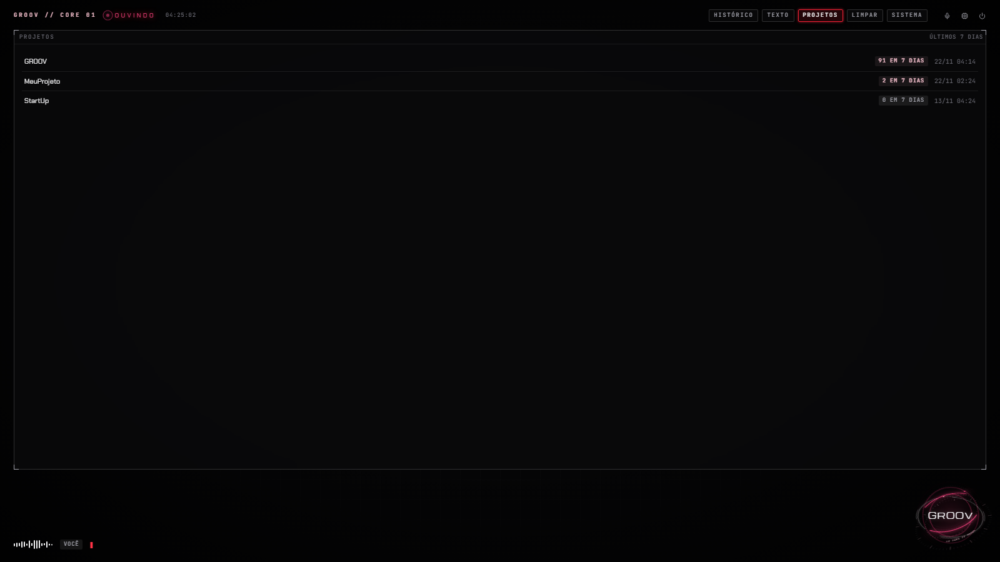
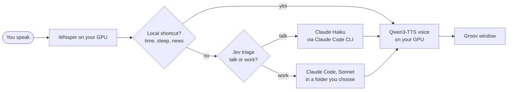

# Groov

**A Brazilian-Portuguese voice assistant for Windows.** Its ears and voice run on your PC. Its brain is Claude, on your own Claude plan.

| Idle | Speaking | Result panels | Claude Code projects |
|---|---|---|---|
|  |  |  |  |

Groov wakes on "Hey JARVIS" or on its name ("groov", "acorda groov"). You talk and it answers out loud, in Portuguese. It can:

- chat, give the time, set timers and read the weather;
- research the web and read back a one-line summary;
- control the PC: open sites and apps, click, type and play media, one checked step at a time;
- hand heavy work to Claude Code in one of your folders and save the result;
- list your Claude Code chats, send them prompts by voice and open them in the Claude app;
- read your Trello boards and keep a daily diary in an Obsidian vault.

The code, prompts and voice are in Portuguese. Only this documentation is in English.

## How it works

Every request takes the cheapest path that can answer it.

- **Tier 1, shortcuts:** the time, going to sleep, shutting down, "news" and "today" are answered on the PC. They use no tokens.
- **Tier 2, conversation:** Claude Haiku answers through the Claude Code CLI. Groov keeps one CLI process open per awake session.
- **Tier 3, work:** `claude -p` (Sonnet) runs in the background in a folder you pick. It writes to `vault/output/` and Groov speaks its summary line.

Jev (TypeSafe) decides between tier 2 and tier 3. Without a TypeSafe key, everything goes to tier 2.

The full design is in [docs/ARCHITECTURE.md](docs/ARCHITECTURE.md).

## What leaves your PC

| Service | When | What is sent | Whose account |
|---|---|---|---|
| Anthropic (Claude Code CLI) | every conversation turn, PC-control step and background task | the text of what you said, the conversation history, your profile and memory notes from the vault and the day's Trello summary; for PC control, the text of the target window and, for visual clicks, a capture of that window only; for tier-3 work, the files Claude Code reads in the folder you chose | **your** Claude Pro/Max plan |
| TypeSafe (Jev), optional | triage of each request; picking an on-screen text line | the request text, your workspace names, the OCR lines of the target window | **your** `TYPESAFE_API_KEY` |
| Google Gemini + Search, optional | research requests | the search query only | **your** `GOOGLE_API_KEY` |
| Open-Meteo | weather and the morning briefing | the coordinates you configure | no account |
| Trello, optional | every 30 min and when you ask for news | read-only API calls (card titles and due dates then reach Claude as context) | **your** `TRELLO_KEY` and `TRELLO_TOKEN` |

These never leave your PC: microphone audio, your voice reference, the synthesized speech, the logs. The vault stays on your disk, but the notes and files listed above go to Claude inside prompts.

## Bring your own accounts

Groov ships no keys and no subscription. Each person who installs it uses their own:

- **Claude Pro or Max plan**, signed in to the [Claude Code CLI](https://docs.claude.com/en/docs/claude-code). Required.
- **TypeSafe key** for Jev triage. Optional.
- **Google AI Studio key** for web research. Optional.
- **Trello key and token**. Optional.

You pay the costs and accept the terms of each service yourself.

## Requirements

- Windows 10 or 11
- NVIDIA GPU with CUDA (Whisper large-v3-turbo and Qwen3-TTS run on it)
- Python 3.12, [uv](https://docs.astral.sh/uv/), Node.js, Google Chrome
- Claude Code CLI, signed in with your plan

Step by step: [docs/INSTALL.md](docs/INSTALL.md).

## Experimental

These parts work in the code but are not yet proven on real use:

- the Claude desktop app docked inside the Groov window (`src/conversa/claude_app.py`);
- waking by name with a real voice (the "Hey JARVIS" model is the reliable path);
- visual clicks on real apps (`src/conversa/visao.py`).

## Third-party licenses

- [React](https://react.dev) (MIT) and [Lucide](https://lucide.dev) icons (ISC), in the window.
- Fonts Chakra Petch, JetBrains Mono and Michroma (SIL Open Font License 1.1); license texts next to the font files.
- [pipecat](https://github.com/pipecat-ai/pipecat) (BSD-2-Clause), [faster-whisper](https://github.com/SYSTRAN/faster-whisper) (MIT), [openWakeWord](https://github.com/dscripka/openWakeWord) (Apache-2.0), [Playwright MCP](https://github.com/microsoft/playwright-mcp) (Apache-2.0), installed by you.
- Qwen3-TTS weights (Apache-2.0), downloaded by you from Hugging Face.
- The "Hey JARVIS" wake-word model (CC BY-NC-SA 4.0, non-commercial), downloaded by you. It is not in this repository.

## License

[MIT](LICENSE).
