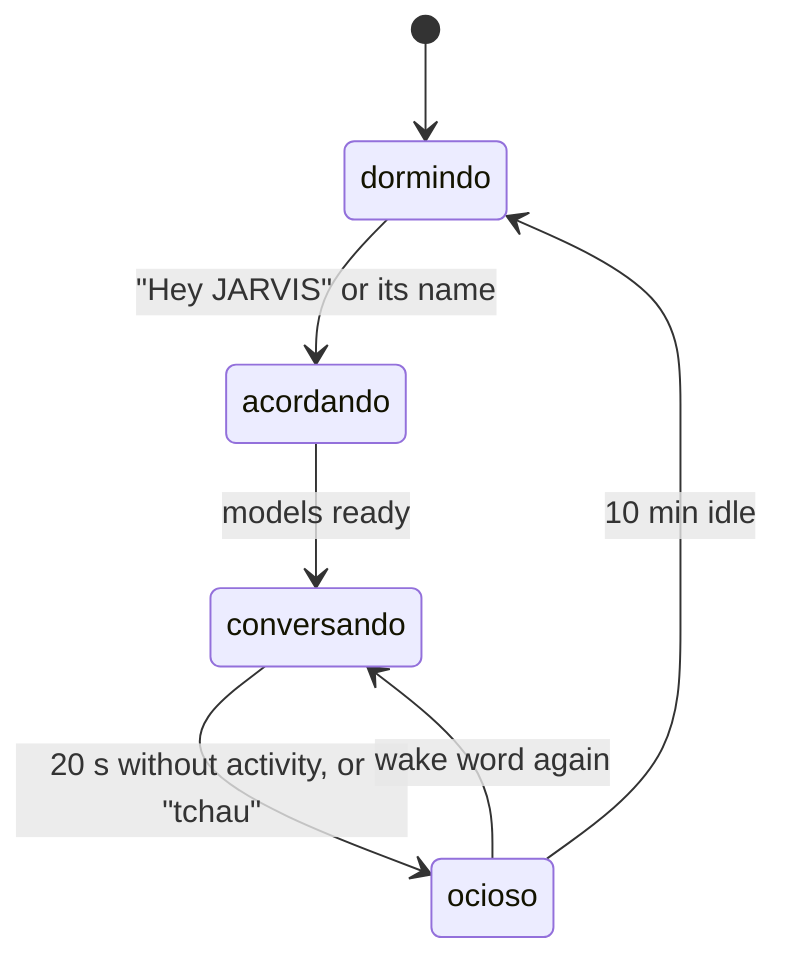
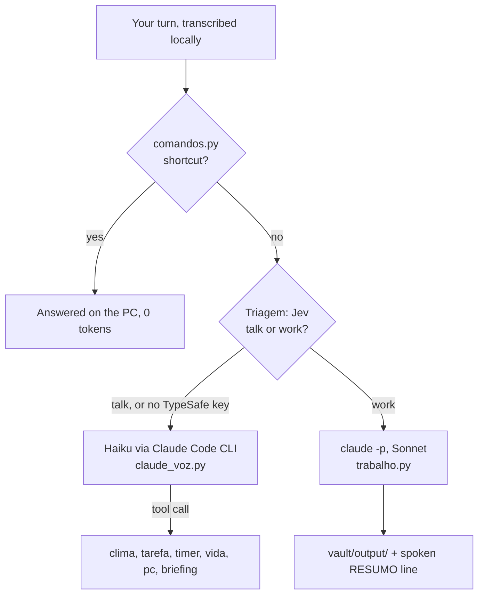
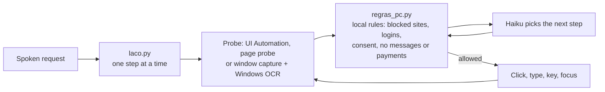
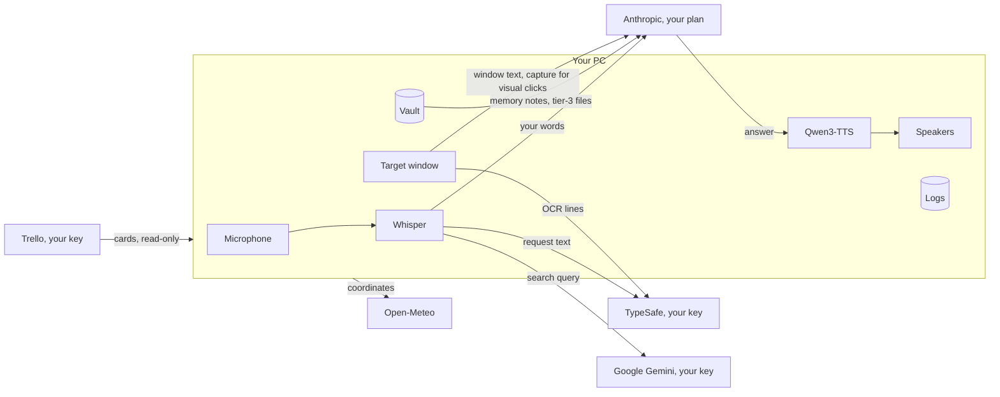

# Architecture

Groov is a streaming voice pipeline built on [pipecat](https://github.com/pipecat-ai/pipecat). A local server (`src/conversa/servidor.py`, `127.0.0.1` only) serves the window and the WebRTC signalling. The window is a Chrome app window. It sends the microphone audio to the server and shows what Groov says and does.

## Session states

- **dormindo (asleep):** only the wake-word gate listens. Audio goes nowhere else.
- **acordando (waking):** the opening plays while the models load; the first wake after the server starts adds a short briefing (date, weather, sea).
- **conversando (talking):** Whisper transcribes each turn and the brain answers.
- **ocioso (idle):** the GPU models stay loaded, so waking again is instant.

## Tiers

The brain is Claude Haiku through the Claude Code CLI, not the API: it runs on the plan of whoever is signed in. Tier 3 runs in the default permission mode with read, web and skill tools plus `Edit(./**)` in the chosen folder. It runs shell commands only if that folder's own settings allow them. It is cancelled when the connection ends.

## PC control

For a visual target, the OCR runs on the PC first. Jev picks the matching text line, and only that line goes to TypeSafe. If that fails, Claude Haiku gets a capture of the target window only. Every visual click passes through `regras_pc.alvo_visual` before it happens.

## Data map

## Modules in `src/conversa/`

| Module | Role |
|---|---|
| `servidor.py` | Local server: serves the window and the WebRTC signalling, `127.0.0.1` only. |
| `bot.py` | The pipeline: wake gate, Whisper, turn handling, triage, brain, TTS by sentence, window. |
| `sessao.py` | Session state: asleep, waking, talking, idle, and the single task slot. |
| `despertador.py` | Wake word: openWakeWord "Hey JARVIS" plus a small local Whisper for the name. |
| `turno.py` | Joins the VAD fragments into one full turn. |
| `comandos.py` | Tier 1 shortcuts and the filter for Whisper hallucinations. |
| `jev.py` | Triage by Jev (TypeSafe): talk or work. |
| `cerebro.py`, `claude_voz.py` | The brain: Haiku through one persistent Claude Code CLI process. |
| `contexto.py` | Trims the history sent to the brain. |
| `ferramentas.py` | Tools the brain can call: weather, research, timers, Trello, PC control. |
| `buscador.py` | Web research through Gemini with Google Search. |
| `trabalho.py` | Tier 3: `claude -p` (Sonnet) in a workspace you choose. |
| `laco.py`, `cerebro_pc.py` | PC-control loop: read, ask Haiku for one step, check it, act, repeat. |
| `regras_pc.py` | Local rules the model cannot override. |
| `pc.py`, `sonda.ps1`, `sonda_pagina.py`, `sonda_ad.py` | Probes that read and act on windows (UI Automation, Playwright MCP page probe, optional agent-desktop). |
| `visao.py` | Finds a described target in a window capture. |
| `janela_pc.py` | Closes and minimizes windows by direct command. |
| `gravacao.py` | Records a successful PC-control run and replays it for the same request. |
| `pergunta.py` | Questions the loop asks you, one at a time. |
| `parada.py` | Stops the running task on "tchau", a timeout or a lost connection. |
| `timers.py` | Simple timers and the shutdown timer. |
| `fala.py` | Turns written text into speakable text. |
| `paineis.py` | Result panels for the window. |
| `chats.py`, `painel_chats.py` | The PROJETOS panel: your Claude Code chats, read locally. |
| `claude_app.py` | Docks the Claude desktop app over the panel (experimental). |
| `vault.py` | Obsidian vault: structure and the daily diary. |
| `segredos.py` | Reads keys from `privado/.env`; they never enter `os.environ`. |
| `tela.py`, `abrir_janela.py` | Hides the window while asleep and shows it full screen on the 2nd monitor when awake. |
| `telemetria.py` | VRAM and latency for the SISTEMA panel. |
| `abertura.py`, `trilha.py` | Opening effects and start-up audio. |
| `log_turno.py`, `mensagens.py`, `mcp_stdio.py` | Turn logs (counts and times only), window messages, a minimal MCP client. |
| `ajudante.py` | Legacy helper for the Hermes agent; not used by default. |
| `janela/` | The window: React 18 UMD, plain JS, no build step. |

Outside `src/conversa/`: `src/config.py` (your non-secret settings), `src/clima.py` and `src/briefing.py` (weather and the morning briefing), `src/voz_servidor.py` (local Qwen3-TTS server) and `src/vida/` (Trello, local database, profile).
